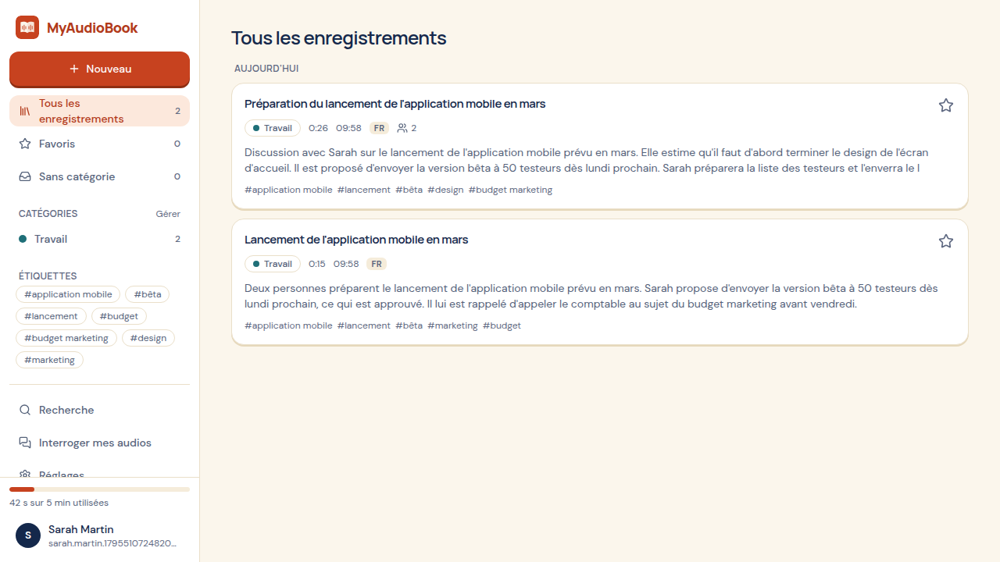

# MyAudioBook

**Parlez. On s'occupe du reste.** Transcription, résumé, tâches et classement de vos notes vocales, en français, hébreu ou anglais. Auto-hébergé : la transcription tourne sur votre propre processeur.

[](LICENSE)

[English](README.md) | Français



**Démo en ligne :** https://my-audio-book.chalco.workers.dev

## Fonctionnalités

- Import, enregistrement dans le navigateur, partage depuis le téléphone (menu Android, Raccourci iPhone).
- Transcription locale (Whisper large-v3-turbo, sur CPU), langue détectée automatiquement.
- Qui parle, quand : détection locale des intervenants.
- Titre, résumé, points clés, tâches, catégorie et étiquettes, par n'importe quel LLM compatible OpenAI (OpenRouter par défaut, Ollama en 100 % local).
- Bibliothèque : filtres, catégories, étiquettes, recherche plein texte.
- Questions sur vos audios, avec liens vers le moment exact.
- Comptes email ou Google, minutes offertes, jetons d'API, export complet, suppression du compte.

## Démarrage rapide (Docker Compose)

```bash
git clone https://github.com/Lomchat/my-audio-book.git
cd my-audio-book
cp .env.example .env
# éditez .env et renseignez LLM_API_KEY (clé OpenRouter : https://openrouter.ai/keys)
docker compose up -d
```

Ouvrez http://localhost:8000 et créez votre compte. Tout le monde a la même interface ; les quotas se gèrent en ligne de commande, par exemple `docker compose exec web python -m app.manage quota vous@exemple.com unlimited`. Au premier démarrage, les modèles vocaux (environ 1,7 Go) sont téléchargés ; suivez l'avancement avec `docker compose logs -f worker`.

Renseignez `PUBLIC_URL` avec l'adresse réellement utilisée, et placez l'application derrière un proxy HTTPS en production.

## Confidentialité

L'audio, les transcriptions et la base restent sur votre serveur. Seul le texte des transcriptions (pour les résumés et la discussion) est envoyé au fournisseur de LLM que vous configurez ; avec Ollama, rien ne quitte votre machine.

## Pour aller plus loin

Configuration complète, proxy inverse (Caddy, nginx), connexion Google, usage mobile, performances, licences des modèles, développement : voir le [README en anglais](README.md) et le dossier [docs/](docs/).

## Licence

[Apache 2.0](LICENSE).
