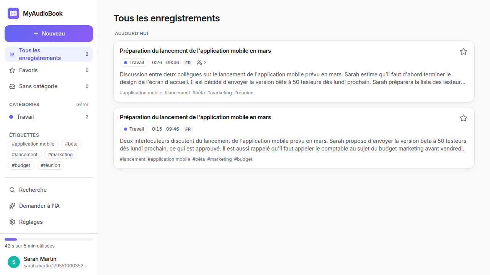
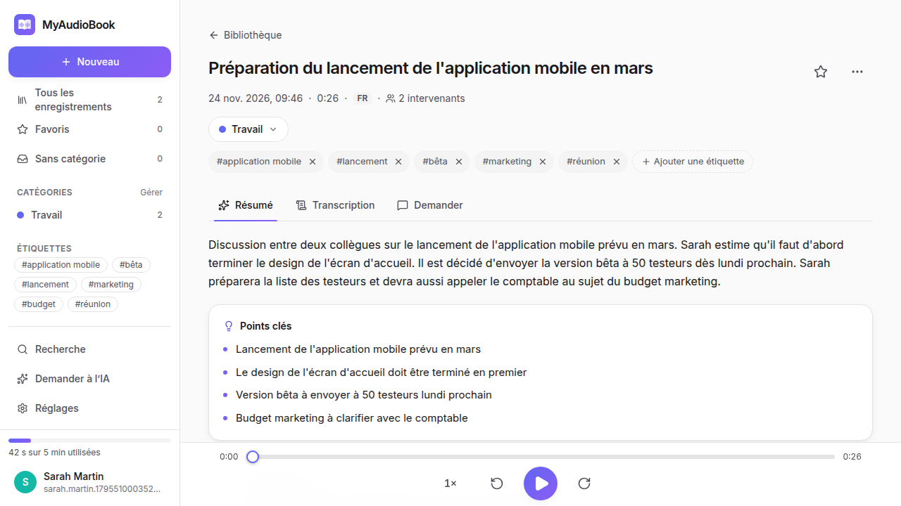
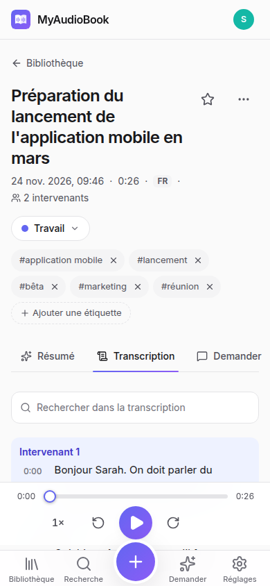

# MyAudioBook

**Record or upload audio, get a transcript, a summary and a chat assistant. Self-hosted, with transcription and speaker detection running on your own CPU.**

[](LICENSE)
[](docker-compose.yml)
[](backend/requirements.txt)
[](frontend)

English | [Français](README.fr.md)



| Recording | Mobile |
| --- | --- |
|  |  |

**Live demo:** https://my-audio-book.chalco.website

## Features

- **Capture from anywhere**: upload files, record in the browser, install the PWA on your phone, share audio to it from the Android share menu, or send recordings from an iPhone Shortcut using an API token.
- **Local transcription**: Whisper large-v3-turbo (via faster-whisper) on CPU, with automatic language detection (French, Hebrew and English by default; configurable).
- **Local speaker detection**: sherpa-onnx with pyannote segmentation 3.0 and WeSpeaker ResNet34 embeddings tells speakers apart.
- **AI notes**: an LLM writes a title, summary, key points and action items, picks a category and adds tags. Any OpenAI-compatible API works (OpenRouter by default, Ollama for a fully local setup).
- **Library**: browse, sort, filter by category and tag, and full-text search (SQLite FTS5).
- **Chat with your recordings**: streamed answers with citations.
- **Accounts**: email and password, optional Google sign-in, password reset by email (optional SMTP), a free quota of audio minutes per account, a daily AI limit. Every account gets the same interface; the server operator manages quotas from the command line.
- **Your data is yours**: API tokens, full data export and account deletion.
- **Single SQLite database**, one Docker image for the web server and the worker. No GPU required.

## Quick start (Docker Compose)

```bash
git clone https://github.com/Lomchat/my-audio-book.git
cd my-audio-book
cp .env.example .env
# edit .env and set LLM_API_KEY (an OpenRouter key: https://openrouter.ai/keys)
docker compose up -d
```

Open http://localhost:8000 and create your account. To give yourself (or anyone) more minutes: `docker compose exec web python -m app.manage quota you@example.com unlimited` (see [Managing accounts](#managing-accounts)).

The first start downloads the speech models (about 1.7 GB) into the data volume, so the first transcription is delayed accordingly. Follow progress with `docker compose logs -f worker`.

Notes:

- Set `PUBLIC_URL` in `.env` to the address people will actually use (it matters for cookies, emails and Google sign-in).
- By default the port is bound to `127.0.0.1`. Put a reverse proxy in front (see below) or set `BIND_ADDRESS=0.0.0.0` to expose it directly.
- Data lives in the named volume `mab-data`. Set `DATA_PATH=./data` to use a folder instead (it must be writable by uid 10001).
- Without `LLM_API_KEY`, recordings are still transcribed, but summaries, categories and chat are unavailable. For a fully local LLM, see the Ollama lines in `.env.example`.

## Configuration

Every setting is an environment variable (set in `.env`). Defaults below come from `backend/app/config.py`. See `.env.example` for commented examples.

### General

| Variable | Default | Description |
| --- | --- | --- |
| `APP_NAME` | `MyAudioBook` | Name shown in the app |
| `PUBLIC_URL` | `http://localhost:8000` | Public address of the instance. `https://` enables secure cookies |
| `EXTRA_ORIGINS` | empty | Other public origins serving the app, comma-separated |
| `DATA_DIR` | `./data` (`/data` in Docker) | Database, audio files and models |
| `MODELS_DIR` | `<DATA_DIR>/models` | Where models are stored |
| `GITHUB_URL` | `https://github.com/Lomchat/my-audio-book` | Link shown in the app |

### LLM (any OpenAI-compatible API)

| Variable | Default | Description |
| --- | --- | --- |
| `LLM_BASE_URL` | `https://openrouter.ai/api/v1` | API base URL (OpenRouter, OpenAI, Ollama, vLLM...) |
| `LLM_API_KEY` | empty | API key. Not needed for local servers on `localhost` / `127.0.0.1` |
| `LLM_MODEL` | `anthropic/claude-sonnet-5.5` | Model name |
| `LLM_REASONING_EFFORT` | empty | OpenRouter only: `low`, `medium` or `high` |
| `LLM_TIMEOUT` | `180` | Request timeout in seconds |

### Accounts and limits

| Variable | Default | Description |
| --- | --- | --- |
| `ALLOW_SIGNUP` | `true` | Allow new sign-ups |
| `FREE_QUOTA_MINUTES` | `5` | Free audio minutes per account, lifetime. `-1` = unlimited |
| `CONTACT_URL` | empty | Link shown when the quota is reached (for example `mailto:` or a WhatsApp link) |
| `MAX_UPLOAD_MB` | `100` | Maximum upload size |
| `MAX_AUDIO_MINUTES` | `180` | Maximum duration of one recording |
| `AI_DAILY_LIMIT` | `50` | Chat messages plus re-summaries per user per day (`-1` = unlimited; accounts with an unlimited quota have no AI limit) |
| `SESSION_DAYS` | `60` | Login session lifetime |

### Google sign-in (optional)

| Variable | Default | Description |
| --- | --- | --- |
| `GOOGLE_CLIENT_ID` | empty | OAuth client ID |
| `GOOGLE_CLIENT_SECRET` | empty | OAuth client secret |

Both are required to enable the button. See [docs/google-sign-in.md](docs/google-sign-in.md).

### Transcription

| Variable | Default | Description |
| --- | --- | --- |
| `WHISPER_MODEL` | `large-v3-turbo` | `large-v3-turbo`, `large-v3`, `medium`, `small`, any faster-whisper repo on Hugging Face, or a local model directory |
| `WHISPER_COMPUTE_TYPE` | `int8` | CTranslate2 compute type |
| `WHISPER_THREADS` | `min(8, CPU count)` | CPU threads for transcription |
| `WHISPER_BEAM_SIZE` | `5` | Beam search size |
| `LANGUAGES` | `fr,he,en` | Languages the detector may choose from (also the ones users can force) |

### Speaker diarization

| Variable | Default | Description |
| --- | --- | --- |
| `DIARIZATION` | `true` | Enable speaker detection |
| `DIARIZATION_THRESHOLD` | `0.5` | Higher means fewer speakers (more merging) |
| `DIARIZATION_THREADS` | `4` | CPU threads for diarization |

### Email (optional, password reset)

| Variable | Default | Description |
| --- | --- | --- |
| `SMTP_HOST` | empty | SMTP server. Password reset is enabled when `SMTP_HOST` and `SMTP_FROM` are set |
| `SMTP_PORT` | `587` | SMTP port |
| `SMTP_USER` / `SMTP_PASSWORD` | empty | Credentials |
| `SMTP_FROM` | empty | Sender address |
| `SMTP_SSL` | `false` | `true` = implicit TLS (port 465); `false` = STARTTLS |

### Docker Compose variables

| Variable | Default | Description |
| --- | --- | --- |
| `PORT` | `8000` | Host port |
| `BIND_ADDRESS` | `127.0.0.1` | Host interface (`0.0.0.0` to expose on your network) |
| `DATA_PATH` | named volume `mab-data` | Host folder for `/data` |
| `WORKER_CPUS` | `8` | CPU cap for the worker container (match `WHISPER_THREADS`) |

## Managing accounts

There is no admin role and no admin screen: everyone uses the same app. Whoever runs the server manages accounts with a small CLI:

```bash
docker compose exec web python -m app.manage users [search]          # accounts and usage
docker compose exec web python -m app.manage quota EMAIL 120         # lifetime quota in minutes
docker compose exec web python -m app.manage quota EMAIL unlimited   # no audio or AI limit
docker compose exec web python -m app.manage quota EMAIL default     # back to FREE_QUOTA_MINUTES
docker compose exec web python -m app.manage disable EMAIL           # block (signs out everywhere); `enable` to undo
docker compose exec web python -m app.manage stats                   # totals, queue, worker state
```

Without Docker, run the same `python -m app.manage …` from `backend/`.

## Using it from a phone

- **Install the app**: open your instance in Chrome (Android) or Safari (iOS) and add it to the home screen.
- **Android**: once installed, MyAudioBook appears in the share menu. Share audio from any recorder app to it.
- **iPhone**: create an API token in Settings and build a Shortcut that posts audio to `/api/recordings`.

Step-by-step instructions: [docs/mobile.md](docs/mobile.md).

## Reverse proxy

Run MyAudioBook behind HTTPS (required for the microphone, PWA install and secure cookies on anything other than localhost). Two things matter: the upload size limit must be at least `MAX_UPLOAD_MB`, and buffering must be off for `/api/chat` so answers stream. Set `PUBLIC_URL` to the public address.

**Caddy**

```caddyfile
audio.example.com {
    request_body {
        max_size 100MB
    }
    reverse_proxy 127.0.0.1:8000 {
        flush_interval -1
    }
}
```

**nginx**

```nginx
server {
    listen 443 ssl;
    server_name audio.example.com;
    # ssl_certificate ... (certbot)

    client_max_body_size 100m;          # >= MAX_UPLOAD_MB

    location / {
        proxy_pass http://127.0.0.1:8000;
        proxy_set_header Host $host;
        proxy_set_header X-Forwarded-For $proxy_add_x_forwarded_for;
        proxy_set_header X-Forwarded-Proto $scheme;
        proxy_read_timeout 300s;
    }

    location /api/chat {
        proxy_pass http://127.0.0.1:8000;
        proxy_set_header Host $host;
        proxy_set_header X-Forwarded-For $proxy_add_x_forwarded_for;
        proxy_set_header X-Forwarded-Proto $scheme;
        proxy_buffering off;            # stream answers
        proxy_read_timeout 300s;
    }
}
```

The container runs uvicorn with `--proxy-headers`, so `X-Forwarded-*` headers are honored.

## Google sign-in

Optional. Create an OAuth client in Google Cloud, register `<origin>/api/auth/google/callback` for `PUBLIC_URL` and each `EXTRA_ORIGINS` entry, then set `GOOGLE_CLIENT_ID` and `GOOGLE_CLIENT_SECRET`. Full walkthrough: [docs/google-sign-in.md](docs/google-sign-in.md).

## Hardware and performance

No GPU needed. Measured on a 48-core server CPU:

| Step | Measurement |
| --- | --- |
| Transcription (large-v3-turbo, int8, 8 threads) | about 3.5x faster than real time |
| Model load | about 4 s |
| Speaker detection | about 3 s for 30 s of audio |
| Worker RAM | about 2 to 3 GB |
| Models on disk | about 1.7 GB |

Smaller machines work too, just slower. Use `WHISPER_THREADS` and `WORKER_CPUS` to match your hardware, or choose a smaller `WHISPER_MODEL` (`small`, `medium`). The worker processes one recording at a time.

## Models and licenses

Models are downloaded on first start (or with `python -m app.modelstore`).

| Model | Use | License | Source |
| --- | --- | --- | --- |
| Whisper large-v3-turbo (CTranslate2 conversion) | Transcription | MIT | OpenAI; conversion by Mobius Labs (`mobiuslabsgmbh/faster-whisper-large-v3-turbo`) |
| pyannote segmentation 3.0 (ONNX) | Speaker segmentation | MIT | pyannote; ONNX export by sherpa-onnx |
| WeSpeaker ResNet34 (VoxCeleb, ONNX) | Speaker embeddings | Apache-2.0 | WeSpeaker; ONNX export by sherpa-onnx |

Runtime libraries: faster-whisper (MIT), sherpa-onnx (Apache-2.0). See [NOTICE](NOTICE). The LLM you configure is governed by its own provider's terms.

## Architecture

```
 phone / browser (React PWA)
          |  HTTPS
          v
   web API (FastAPI) --- SQLite (WAL, FTS5) + /data/audio  --- worker (faster-whisper, sherpa-onnx)
          |                                                        |
          +------------- LLM (OpenAI-compatible API) <-------------+
```

The web API stores uploads and queues a job in SQLite. A separate worker process picks jobs one at a time: it converts the audio with ffmpeg, transcribes it, detects speakers, then asks the LLM for the notes and indexes everything for search. Details: [docs/architecture.md](docs/architecture.md). Interactive API docs are served at `/api/docs`.

## Privacy

Stays on your server:

- audio files, transcripts, speaker detection, the database and search index;
- accounts, password hashes (argon2) and sessions.

Sent to the LLM provider you configure (`LLM_BASE_URL`):

- the transcript text of a recording, to produce the title, summary, key points, action items, category and tags;
- the relevant transcript excerpts and your question, when you chat with your recordings.

Audio itself is never sent to the LLM. With Ollama or another local server, nothing leaves your machine. If you enable Google sign-in, Google receives the sign-in request (and returns your email and profile name).

## Development

Requirements: Python 3.12, Node 24, ffmpeg.

```bash
# Backend
python -m venv .venv
.venv/bin/pip install -r backend/requirements.txt
cp .env.example .env            # set LLM_API_KEY
cd backend
python -m app.modelstore        # download models (also automatic on worker start)
uvicorn app.main:app --reload   # API on :8000
python -m app.worker            # in a second terminal

# Frontend (Vite proxies /api to :8000)
cd frontend
npm install
npm run dev
npm run build                   # output in frontend/dist, served by FastAPI

# Tests
cd backend && pytest
```

## Project structure

```
backend/
  app/
    main.py          FastAPI app, security headers, SPA serving
    config.py        settings (environment variables)
    routers/         auth, google, recordings, library, chat, account, meta
    manage.py        command-line account management (quotas, disable, stats)
    worker.py        job queue consumer
    pipeline.py      prepare -> transcribe -> diarize -> summarize -> index
    stt.py, diarize.py, llm.py, search.py, mailer.py, modelstore.py
    db.py, security.py, audio.py
  tests/             a few critical tests
frontend/            Vite + React + TypeScript + Tailwind PWA
docs/                guides
Dockerfile, docker-compose.yml, .env.example
```

## Contributing

Contributions are welcome. Read [CONTRIBUTING.md](CONTRIBUTING.md) first. To report a vulnerability, see [SECURITY.md](SECURITY.md).

## License

[Apache License 2.0](LICENSE). Third-party notices are in [NOTICE](NOTICE).
